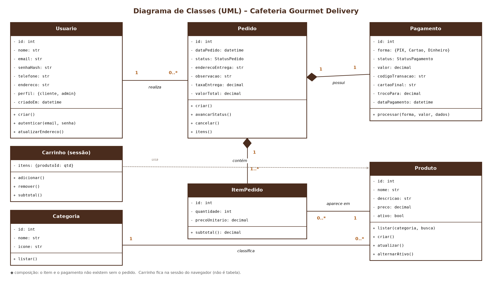
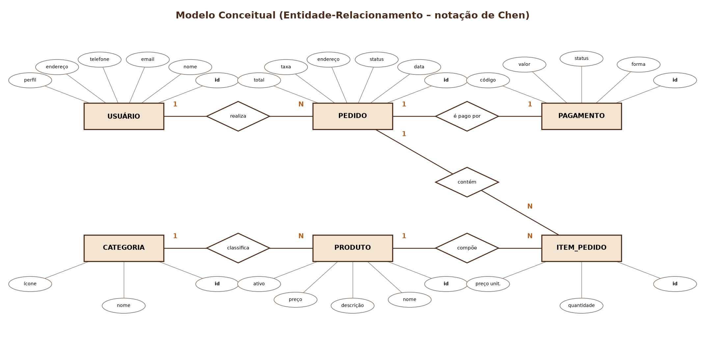
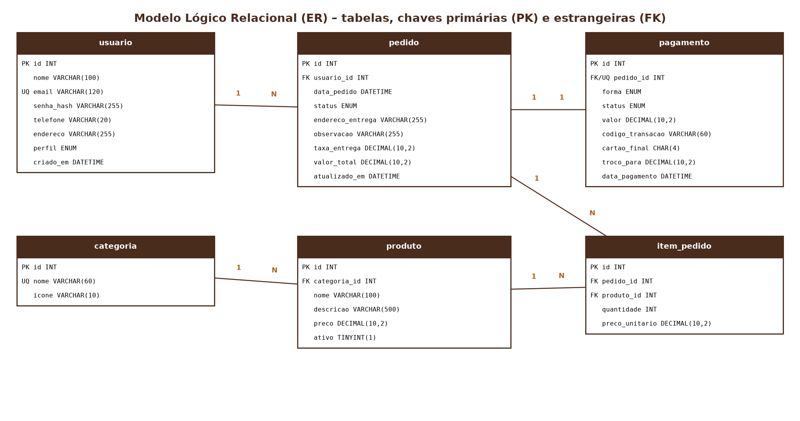

# ☕ Cafeteria Gourmet Delivery

Sistema web de delivery para uma cafeteria gourmet: o cliente vê o cardápio, monta o carrinho, paga online e acompanha a entrega. A equipe da cafeteria tem um painel para mudar o status dos pedidos e cuidar do cardápio.

Projeto Integrador Transdisciplinar em Sistemas de Informação II. Aluna: Sophya Damiazo, RGM 40917932.

## Funcionalidades
- **Cliente:** cadastro e login, cardápio com busca e filtro por categoria, carrinho, pagamento (PIX, cartão ou dinheiro com troco), acompanhamento do pedido em tempo real, histórico e cancelamento
- **Cafeteria (admin):** painel de pedidos com filtro por status, avanço de etapas (Recebido → Em preparo → Saiu para entrega → Entregue) e gestão do cardápio

## Modelagem
| Diagrama de classes | Modelo conceitual | Modelo lógico (ER) |
|---|---|---|
|  |  |  |

O projeto físico está em [`database/schema_mysql.sql`](database/schema_mysql.sql).

## Tecnologias
- **Back-end:** Python 3 + Flask, no padrão **MVC**
- **Front-end:** HTML5, CSS3 e JavaScript puro, com layout responsivo
- **Banco de dados:** SQLite na execução e script MySQL 8 do projeto físico (`database/schema_mysql.sql`)
- **Testes:** pytest, com 33 testes unitários e de integração

## Como rodar

```bash
cd cafeteria_delivery
python -m venv .venv
.venv\Scripts\activate          # Windows  (Linux/Mac: source .venv/bin/activate)
pip install -r requirements.txt
python run.py
```
Depois é só abrir **http://127.0.0.1:5000**. O banco é criado sozinho na primeira execução, no arquivo `instance/cafeteria.sqlite`.

Para apagar e recriar o banco: `flask --app run init-db`

### Usuários de teste
| Perfil | E-mail | Senha |
|---|---|---|
| Administrador (equipe da cafeteria) | admin@cafeteria.com | admin123 |
| Cliente | cliente@teste.com | 123456 |

Para pagar com cartão nos testes, use o número **4111 1111 1111 1111**, qualquer validade futura (ex.: 12/30) e CVV 123. O pagamento é **simulado** e não tem cobrança real.

## Rodar os testes
```bash
python -m pytest -v
```

## Estrutura (MVC)
```
cafeteria_delivery/
├── run.py                     # ponto de entrada
├── app/
│   ├── __init__.py            # fábrica da aplicação
│   ├── db.py                  # conexão e criação do banco
│   ├── models/                # MODEL: regras de negócio, validação, SQL
│   │   ├── usuario.py  produto.py  carrinho.py  pedido.py
│   ├── controllers/           # CONTROLLER: rotas (Blueprints)
│   │   ├── loja_controller.py  auth_controller.py  carrinho_controller.py
│   │   ├── pedido_controller.py  admin_controller.py
│   ├── templates/             # VIEW: páginas HTML (Jinja2)
│   └── static/                # VIEW: CSS e JavaScript
├── database/
│   ├── schema_mysql.sql       # projeto físico (MySQL)
│   └── schema_sqlite.sql      # mesma estrutura em SQLite
├── tests/                     # testes automatizados (pytest)
└── docs/                      # documentação de entrega
```

## Publicação (Render, plano gratuito)

🌐 **Online:** https://cafeteria-gourmet-delivery.onrender.com

[](https://render.com/deploy?repo=https://github.com/SophyaDamiazo/cafeteria-gourmet-delivery)

O arquivo [`render.yaml`](render.yaml) já traz toda a configuração: Python 3.12, Gunicorn e uma `SECRET_KEY` gerada automaticamente. Cada `git push` no GitHub publica a versão nova sozinho.

> No plano gratuito o servidor "dorme" depois de 15 minutos sem acesso, e o **primeiro acesso depois disso leva uns 50 segundos** pra carregar. Quando ele reinicia, o banco SQLite volta aos dados iniciais, mas os usuários de teste e o cardápio são recriados automaticamente.
